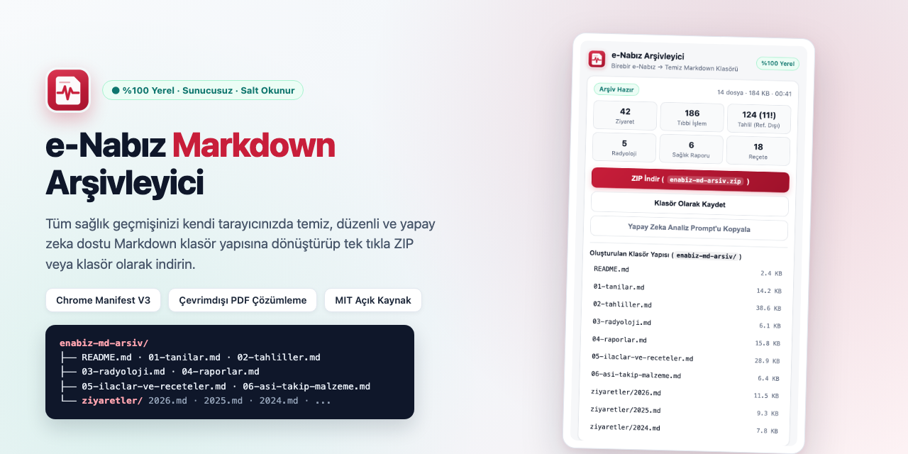
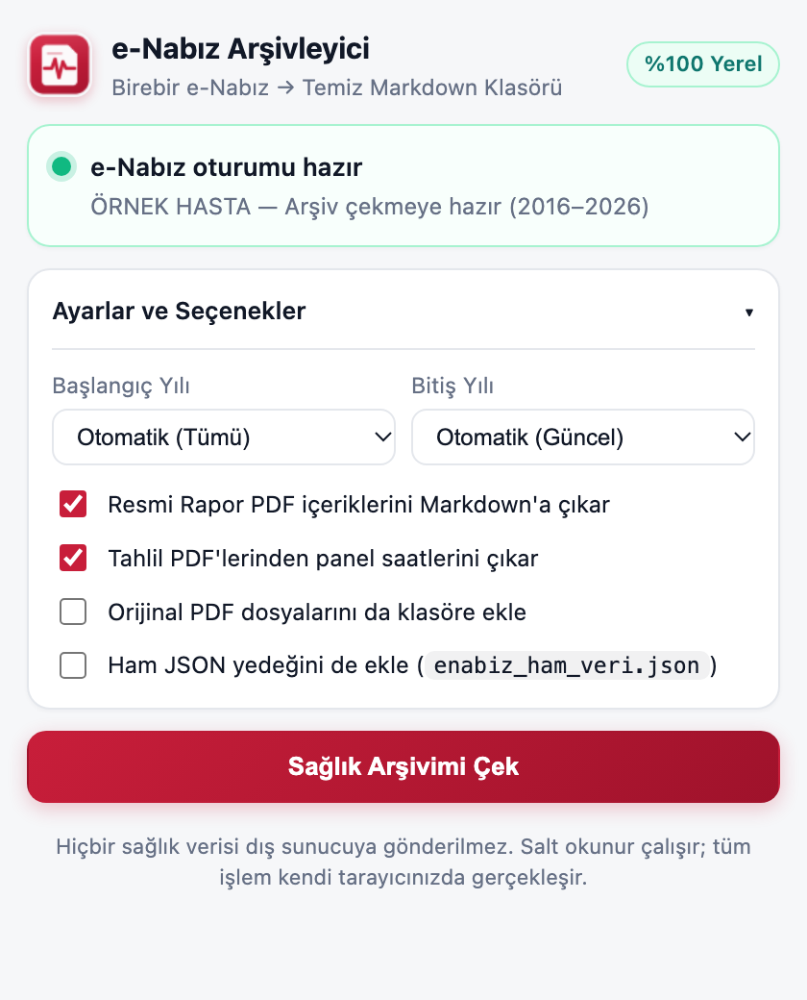
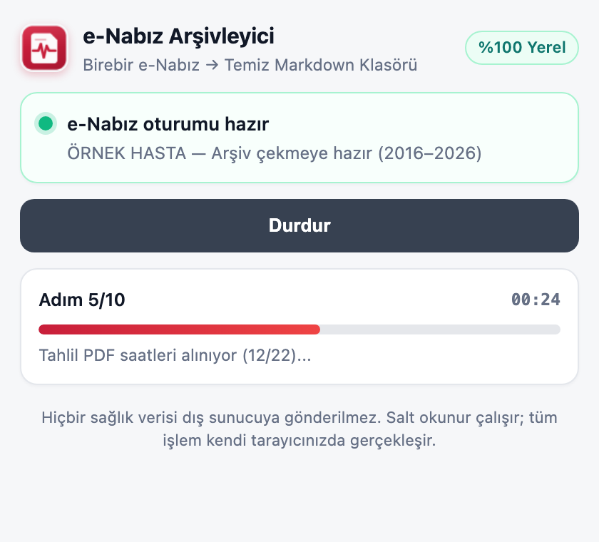
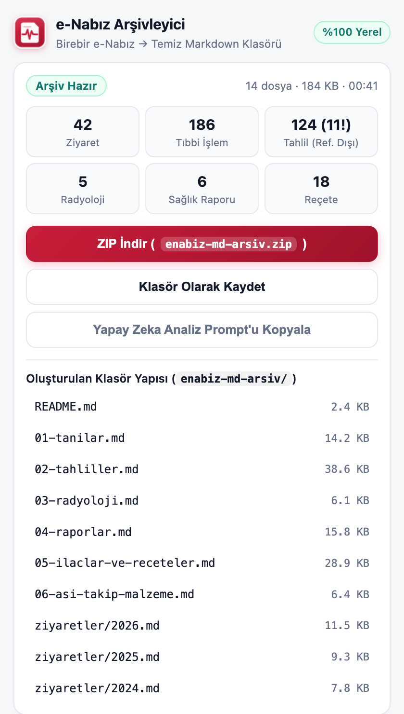

> [!WARNING]
> **Bu proje "vibecoded" bir projedir.** Kodun büyük bölümü yapay zeka yardımıyla yazılmıştır ve profesyonel bir yazılım ekibi tarafından denetlenmemiştir. Olduğu gibi, hiçbir garanti verilmeden sunulur. Çıktıları tıbbi karar için tek kaynak olarak kullanmayın; önemli bilgileri her zaman e-Nabız'daki orijinal kayıtlarla karşılaştırın.

<div align="center">



<br/><br/>

[](https://github.com/atahansocial/enabiz-md-exporter/actions/workflows/ci.yml)
[](LICENSE)
[](manifest.json)
[](SECURITY.md)

**Tüm e-Nabız sağlık geçmişinizi kendi tarayıcınız içinde %100 yerel olarak temiz, düzenli ve yapay zeka dostu Markdown (`enabiz-md-arsiv/`) klasörüne dönüştürüp tek tıkla ZIP veya klasör olarak indiren açık kaynaklı Chrome eklentisi.**

*Open-source, zero-backend Chrome Manifest V3 Side Panel extension that exports your Turkish e-Nabız personal health records into a clean, AI-ready Markdown folder structure locally in your browser.*

[Kurulum](#kurulum-chrome--edge--brave--arc) · [Ekran Görüntüleri](#ekran-görüntüleri) · [Klasör Yapısı](#çıktı-klasör-yapısı-enabiz-md-arsiv) · [Mimari](#mimari) · [Değişiklik Günlüğü](CHANGELOG.md)

</div>

---

## Ekran Görüntüleri

| 1. Oturum & Ayarlar | 2. Canlı İlerleme Takibi | 3. Özet, Dosya Önizleme & İndirme |
| :---: | :---: | :---: |
|  |  |  |

---

## Öne Çıkan Özellikler

- **Tek Tıkla Tam Arşiv:** Ziyaretler, ICD-10 tanılar, işlemler, yazılan/alınan reçeteler, çoklu ve tekil tahlil panelleri (`Tekil Tetkikler`), COVID-19 testleri, radyoloji raporları, resmi sağlık raporları, aşı takvimi, kronik taramalar, randevular ve tıbbi malzemelerin tamamını çeker.
- **Çevrimdışı Türkçe PDF Çözümleme:** Resmi sağlık raporlarının (İstirahat, Durum Bildirir, Sürücü, Sağlık Kurulu vb.) PDF içeriklerini ve tahlil panellerinin saat bilgilerini eklenti içine gömülü Mozilla [`pdfjs-dist`](vendor/README.txt) ile tamamen tarayıcı içinde UTF-8 olarak çözümler; e-imza ve tekrarlayan kimlik alt/üst bilgilerini temizler.
- **Referans Dışı Otomatik Sınıflandırma:** Tahlil sonuçlarını referans aralıklarına göre otomatik olarak `Yüksek ↑`, `Düşük ↓`, `Referans Dışı` ve `Normal` olarak etiketler.
- **ZIP veya Doğrudan Klasör Kaydı:** İster tek bir `enabiz-md-arsiv-YYYY-AA-GG.zip` dosyası indirin, isterseniz File System Access API ile doğrudan diskinizde `enabiz-md-arsiv/` klasörü oluşturun.
- **Yapay Zeka Uyumlu:** Dosya içi önizleme ve tek tıkla **"Yapay Zeka Analiz Prompt'u Kopyala"** butonu ile arşivinizi kolayca özetleyip trend/korelasyon analizi alabilirsiniz.

---

## İzinler ve Gizlilik Denetimi

Bu proje **sıfır telemetri**, **sıfır harici sunucu** ve **salt okunur (read-only)** ilkeleriyle geliştirilmiştir. Detaylar için [SECURITY.md](SECURITY.md) dosyasını inceleyebilirsiniz.

| Manifest İzni | Kullanım Amacı |
|---|---|
| `sidePanel` | Eklenti arayüzünü tarayıcının yan panelinde göstermek |
| `tabs` | Aktif sekmenin `https://enabiz.gov.tr` üzerinde olup olmadığını anlamak |
| `scripting` | Eklenti yüklenmeden önce açılmış e-Nabız sekmesine kullanıcı başlattığında `src/content.js` bağlamak |
| `downloads` | Oluşturulan `enabiz-md-arsiv.zip` dosyasını bilgisayara indirmek |
| `https://enabiz.gov.tr/*` | Yalnızca kendi aktif oturumunuz üzerinden salt okunur veri çekmek (başka hiçbir domain izni yoktur) |

---

## Çıktı Klasör Yapısı (`enabiz-md-arsiv/`)

```text
enabiz-md-arsiv/
├── README.md                    # Kişisel profil, genel özet ve yıl dosya linkleri
├── 01-tanilar.md                # ICD-10 tanı sıklıkları + Hastalıklarım tam listesi
├── 02-tahliller.md              # Referans dışı sonuçlar + tüm tahlil panelleri
├── 03-radyoloji.md              # Radyolojik incelemeler ve temizlenmiş tam rapor metinleri
├── 04-raporlar.md               # Sağlık raporları listesi + resmi PDF'lerin klinik özeti
├── 05-ilaclar-ve-receteler.md   # Reçete detayları (yazılan/alınan) + İlaçlarım kronolojisi
├── 06-asi-takip-malzeme.md      # Aşılar, kronik taramalar, randevular, malzemeler ve ek bölümler
└── ziyaretler/
    ├── 2026.md                  # Yıllara göre tüm ziyaret, tanı, işlem, tahlil ve reçeteler
    ├── 2025.md
    └── ...
```

*(İsteğe bağlı ayarlardan orijinal PDF dosyalarını ve ham JSON yedeğini de arşive dahil edebilirsiniz.)*

---

## Kurulum (Chrome / Edge / Brave / Arc)

1. Bu repoyu bilgisayarınıza indirin:
   ```bash
   git clone https://github.com/atahansocial/enabiz-md-exporter.git
   ```
   *(veya sağ üstten **Code → Download ZIP** ile indirip klasöre çıkarın)*
2. Tarayıcınızda **`chrome://extensions`** adresini açın ve sağ üstten **Geliştirici modu (Developer mode)** anahtarını açın.
3. **Paketlenmemiş öğe yükle (Load unpacked)** butonuna tıklayıp `enabiz-md-exporter` klasörünü seçin.
4. [`https://enabiz.gov.tr`](https://enabiz.gov.tr) sekmesinde e-Devlet veya şifrenizle giriş yapın.
5. Eklenti simgesine tıklayarak yan paneli açın ve **"Sağlık Arşivimi Çek"** butonuna basın.

---

## Yapay Zeka ile Analiz

Arşiviniz indirildikten sonra yan paneldeki **"Yapay Zeka Analiz Prompt'u Kopyala"** butonuna basın ve `enabiz-md-arsiv/` klasöründeki `.md` dosyalarıyla birlikte tercih ettiğiniz yapay zeka asistanına gönderin. Markdown dosyaları gereksiz HTML/hukuki tekrar metinlerinden arındırıldığı için bağlam penceresini çok verimli kullanır.

---

## Mimari

```text
https://enabiz.gov.tr (Aktif Oturum)
   │
   ▼  salt okunur fetch (XSRF + credentials: 'include')
src/content.js ──(IPC + PDF chunk stream)──► src/sidepanel.js
                                               │
                                               ├──► src/lib/pdf-extractor.js (vendor/pdf.min.mjs)
                                               ├──► src/lib/markdown-builder.js (17+ .md dosyası)
                                               └──► src/lib/zip.js (UTF-8 Deflate ZIP) / Klasör
```

- [manifest.json](manifest.json) — Manifest V3 yapılandırması (`minimum_chrome_version: 119`) ve sıkı CSP kuralları
- [src/background.js](src/background.js) — Yan panel açılış davranışı
- [src/lib/dom-parsers.js](src/lib/dom-parsers.js) — Türkçe başlık eşlemeli ve Node'da test edilebilir paylaşılan DOM ayrıştırıcıları
- [src/content.js](src/content.js) — Yıl keşfi, zaman aşımlı/uyarlanabilir hızda salt okunur veri toplama ve kalıcı port akışı
- [src/sidepanel.js](src/sidepanel.js) — Watchdog, `runId` izolasyonu, aşamalı PDF işleme ve erişilebilir yan panel arayüzü
- [src/lib/pdf-extractor.js](src/lib/pdf-extractor.js) — Çevrimdışı `pdf.js` metin çıkarımı ve Türkçe rapor temizleyici
- [src/lib/markdown-builder.js](src/lib/markdown-builder.js) — Tanı/tahlil analizi, kısmi başarı uyarıları ve Markdown klasör üreticisi
- [src/lib/zip.js](src/lib/zip.js) — Bağımlılıksız UTF-8 + Deflate ZIP paketleyici
- [tests/verify-builder.mjs](tests/verify-builder.mjs) — Sentetik veriyle uçtan uca Markdown & ZIP doğrulama paketi
- [tests/verify-parsers.mjs](tests/verify-parsers.mjs) — Seçici ve başlık eşlemeli DOM ayrıştırıcı testleri

---

## Lisans

Bu proje [MIT Lisansı](LICENSE) ile lisanslanmıştır.
